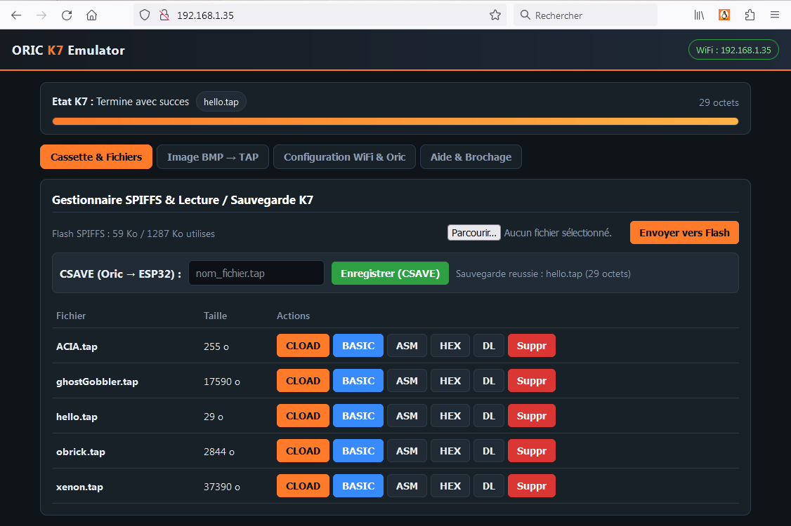

# Oric K7 Emulator (`K7emunew` — ESP32 Web & Stand-Alone)

Émulateur de lecteur de cassette (K7) pour **Oric 1 / Oric Atmos** basé sur **ESP32 (WEMOS LOLIN32)** avec interface Web intégrée en mémoire Flash (`PROGMEM`), écran OLED SSD1306, encodeur rotatif et pont Telnet ↔ ACIA 6551.

---


## 1. Nouveautés & Architecture

- **Zéro ligne de commande, zéro FTP** : toute la configuration et la gestion des fichiers se font depuis l'interface **Web + CSS** (ou directement via l'écran OLED et l'encodeur rotatif en mode autonome).
- **Interface Web en Flash (`PROGMEM`)** : la page HTML/CSS/JS est compilée dans le firmware et **ne dépend pas du SPIFFS**. Un formatage du SPIFFS n'efface jamais l'interface Web.
- **Timing cassette préservé** : pendant `CLOAD` et `CSAVE`, le Core 1 est dédié à la génération/capture FSK par timer matériel sans interruption réseau, garantissant des chargements sans erreur.
- **Fonctionnement Stand-Alone** : même sans réseau WiFi, l'écran OLED et l'encodeur rotatif restent opérationnels pour lancer `CLOAD` et `CSAVE`.

---

## 2. Fonctionnalités

### Interface Web (Port `80`)
1. **Cassette & Gestionnaire SPIFFS** :
   - Visualisation de l'espace Flash SPIFFS utilisé / total.
   - Upload de fichiers `.tap`, `.bmp`, `.txt` directement dans la Flash interne de l'ESP32.
   - Téléchargement (`DL`), suppression (`Suppr`) et formatage SPIFFS.
   - **CLOAD intelligent** :
     - Affiche immédiatement le nom du fichier sélectionné à côté de la barre de progression.
     - Cliquer plusieurs fois sur le même `.tap` n'empile pas de file d'attente.
     - Cliquer sur un autre `.tap` pendant l'attente du `CLOAD` remplace la sélection en cours.
     - Barre de progression calibrée sur la vitesse réelle (`FAST` / `FAST16`) incluant le préambule de synchronisation (`256 × 0x16 + 0x24 + en-tête + nom + gap`).
   - **CSAVE Web** : saisie du nom `.tap` et suivi d'état en direct (*Attente CSAVE*, *Enregistrement*, *Sauvegarde réussie : X octets*, *Timeout*).
2. **Outils intégrés** :
   - **BASIC** : décodage et affichage du listing BASIC d'un fichier `.tap`.
   - **ASM** : désassemblage 6502 d'un programme binaire `.tap` (avec sauvegarde optionnelle en `.txt` dans la Flash).
   - **HEX** : affichage hexadécimal et ASCII du contenu d'un fichier.
   - **Convertisseur BMP → TAP** : conversion d'une image BMP monochrome `240×200` stockée en Flash vers un fichier `.tap` HIRES.
3. **Configuration WiFi & Oric** :
   - Choix du mode **Point d'Accès (`ORIC_AP`)** ou **Client WiFi (Box / Routeur)**.
   - Saisie du **SSID** et du **mot de passe** WiFi.
   - Choix de la vitesse `CLOAD` : **Normal (`FAST`)** ou **Rapide (`FAST16`, ~1,4×)**.
   - Activation/désactivation du pont **Telnet (port 23) ↔ ACIA 6551 (`UART2` `9600` bauds)**.

### Pont Telnet ↔ ACIA 6551 (Port `23`)
- Relie un client Telnet sur le port TCP `23` au port série `UART2` (`GPIO 16` RX2 / `GPIO 17` TX2, `9600` bauds, `8N1`) connecté à l'ACIA 6551 de l'Oric.

---

## 3. Mise en route rapide

1. **Premier démarrage (Mode Point d'Accès)** :
   - L'ESP32 crée le réseau WiFi **`ORIC_AP`** (mot de passe : `oricatmos`).
   - L'écran OLED affiche `A:192.168.4.1`.
   - Connectez-vous à `ORIC_AP` puis ouvrez `http://192.168.4.1` dans votre navigateur.
2. **Connexion à votre box fibre (Mode Client)** :
   - Dans l'onglet **Configuration WiFi & Oric**, sélectionnez **Client WiFi**, entrez votre **SSID** et **mot de passe**, puis cliquez sur **Enregistrer & Redémarrer**.
   - Au redémarrage, l'écran OLED affiche `C:192.168.x.x` : ouvrez `http://192.168.x.x`.
   - *Repli automatique* : si la box est hors de portée, l'ESP32 repasse automatiquement en mode `ORIC_AP` (`192.168.4.1`).
   - *Forcer le mode AP* : tirez `GPIO 26` à la masse (`GND`) au démarrage.
3. **Utilisation Stand-Alone (OLED + Encodeur rotatif)** :
   - Tournez l'encodeur pour choisir `CLOAD` ou `CSAVE`, cliquez pour valider.
   - Pour `CLOAD`, sélectionnez le fichier `.tap` puis lancez `CLOAD""` sur l'Oric.
   - Pour `CSAVE`, composez le nom du fichier, validez sur l'icône **OK**, puis lancez `CSAVE"NOM"` sur l'Oric.

---

## 4. Brochage ESP32 (WEMOS LOLIN32)

| Fonction | GPIO ESP32 | Détails |
| :--- | :--- | :--- |
| **K7 OUT (ESP32 → Oric)** | `19` | Sortie signal FSK (`CLOAD`) |
| **K7 IN (Oric → ESP32)** | `18` | Entrée signal FSK (`CSAVE`) |
| **K7 REMOTE** | `5` | Détection commande moteur K7 Oric |
| **LED statut** | `2` | Clignotement lors des transferts K7 |
| **OLED SSD1306 (I2C)** | `SDA` / `SCL` | Adresse `0x3C`, `128×64` |
| **Encodeur rotatif** | `14` (A), `27` (B), `25` (SW) | Navigation Stand-Alone |
| **UART2 / ACIA 6551** | `16` (RX2), `17` (TX2) | Pont Telnet port `23` (`9600` bauds) |
| **Forcer mode AP** | `26` | Tirer à `GND` au démarrage pour forcer `ORIC_AP` |

---

## 5. Compilation et Flashage (PlatformIO)

Le projet utilise `platform = espressif32 @ 6.9.0` (`board = lolin32`, `framework = arduino`) configuré dans [platformio.ini](file:///home/alecren/Documents/oric/K7emunew/platformio.ini).

```bash
cd K7emunew
pio run
pio run -t upload
```

- Port série par défaut : `/dev/ttyUSB0`
- Binaire compilé : [k7emulator_esp32.bin](file:///home/alecren/Documents/oric/K7emunew/k7emulator_esp32.bin)
