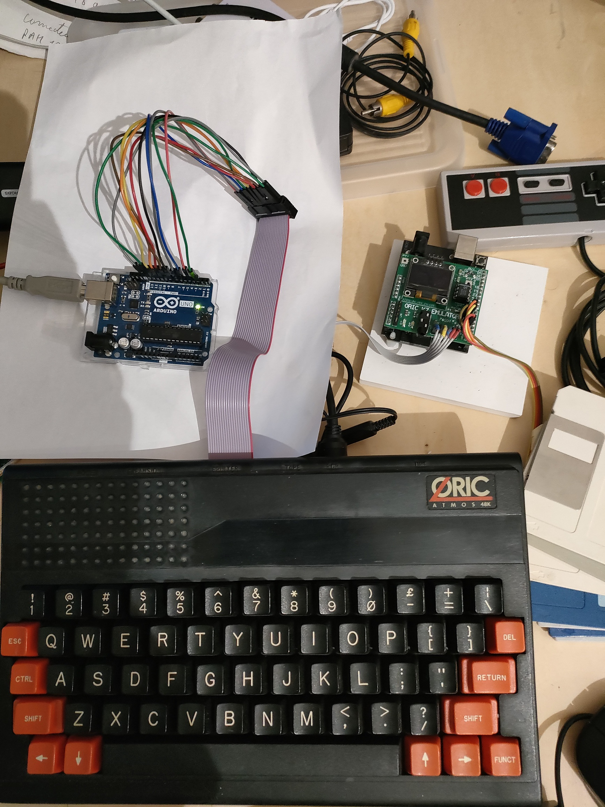
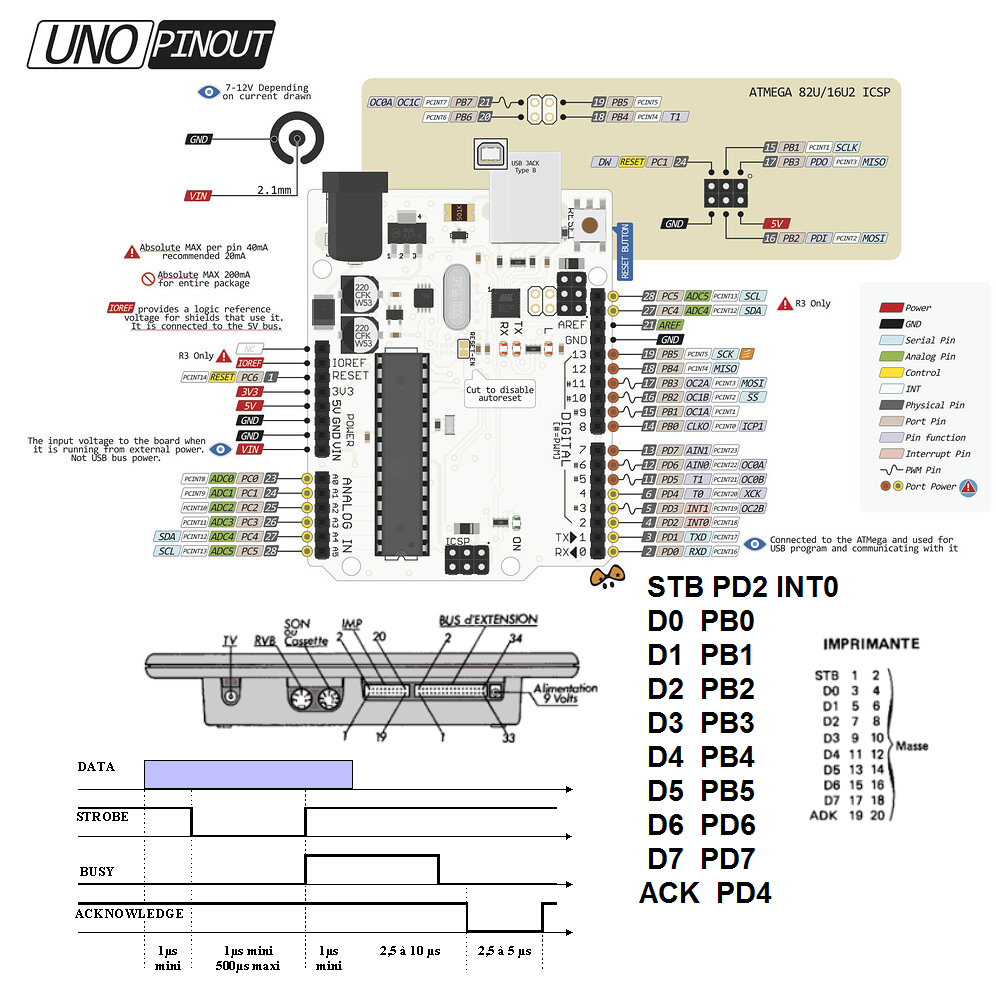

# Oric Atmos to USB - Centronics Dumper & Receiver 🕹️🖨️

Ce projet permet de connecter un micro-ordinateur vintage **Oric Atmos** (ou Oric 1) à un ordinateur moderne via un **Arduino Uno**. L'Arduino fait office de récepteur parallèle (émulation d'imprimante Centronics) et renvoie les octets reçus en temps réel sur la liaison série USB à 115 200 bauds.

Le système utilise une gestion par **interruption matérielle (ISR)** et une **lecture directe des registres (AVR)** pour garantir le respect strict des timings critiques du protocole Centronics (notamment l'impulsion `STROBE` et la réponse `ACK`).



---

## 🛠️ Schéma de Câblage

Le port d'extension de l'Oric Atmos (via son bus d'imprimante) est relié aux broches de l'Arduino Uno selon la configuration optimisée suivante :


### 1. Lignes de Contrôle

| Signal Centronics | Broche Oric (Imprimante) | Broche Arduino Uno | Registre / Fonction |
|:-----------------:|:------------------------:|:------------------:|:-------------------:|
| **STROBE**        | 1                        | **Pin 2**          | `PD2` (INT0)        |
| **ACK**           | 19                       | **Pin 4**          | `PD4` (Sortie)      |
| **GND / Masse**   | 2 à 20 (Pair)            | **GND**            | Masse commune       |

### 2. Lignes de Données (Bus 8-bits)
Pour maximiser la vitesse de lecture lors du signal `STROBE`, le bus de données est réparti intelligemment sur les ports natifs de l'ATmega328P (`PORTB` et `PORTD`) :

| Donnée | Broche Oric | Broche Arduino Uno | Bit Registre |
|:------:|:-----------:|:------------------:|:------------:|
| **D0** | 3           | **Pin 8**          | `PB0`        |
| **D1** | 5           | **Pin 9**          | `PB1`        |
| **D2** | 7           | **Pin 10**         | `PB2`        |
| **D3** | 9           | **Pin 11**         | `PB3`        |
| **D4** | 11          | **Pin 12**         | `PB4`        |
| **D5** | 13          | **Pin 13**         | `PB5`        |
| **D6** | 15          | **Pin 6**          | `PD6`        |
| **D7** | 17          | **Pin 7**          | `PD7`        |



---

## 💾 Code Source Arduino (`.ino`)

Ce code doit être téléversé sur l'Arduino Uno. Il utilise l'interruption `INT0` déclenchée sur le front descendant du signal `STROBE` émis par l'Oric.

```cpp
#include <Arduino.h>

// Définition des broches de contrôle (Signaux Centronics)
#define STROBE_PIN  2   // PD2 (INT0) - Entrée
#define ACK_PIN     4   // PD4 - Sortie

// Configuration des données documentée pour rappel :
// D0->Pin 8 (PB0), D1->Pin 9 (PB1), D2->Pin 10 (PB2), D3->Pin 11 (PB3)
// D4->Pin 12 (PB4), D5->Pin 13 (PB5), D6->Pin 6 (PD6), D7->Pin 7 (PD7)

volatile uint8_t receivedByte = 0;
volatile bool dataReady = false;

// Routine d'interruption (ISR) sur front descendant de STROBE (INT0)
void instanceStrobeISR() {
  // Lecture instantanée des ports pour reconstituer l'octet
  uint8_t portB_bits = PINB; // Lit PB0 à PB5 (Broches 8 à 13)
  uint8_t portD_bits = PIND; // Lit PD6 et PD7 (Broches 6 et 7)

  // Reconstruction du mot de 8 bits :
  // Les 6 bits de poids faible (D0-D5) viennent du bas de PORTB (masque 0x3F)
  // Les 2 bits de poids fort (D6-D7) viennent du haut de PORTD (D6 sur bit 6, D7 sur bit 7)
  receivedByte = (portB_bits & 0x3F) | (portD_bits & 0xC0);
  
  dataReady = true;

  // Envoi de l'impulsion négative sur ACK (Actif à l'état bas)
  PORTD &= ~(1 << PD4); // ACK passe à 0
  delayMicroseconds(5); // Durée de l'impulsion ACK (~5µs règlementaires)
  PORTD |= (1 << PD4);  // ACK repasse à 1
}

void setup() {
  // Initialisation de la liaison série à 115200 bauds
  Serial.begin(115200);

  // Configuration des lignes de données en ENTRÉE
  DDRB &= ~0x3F; // Broches 8 à 13 (PB0 à PB5)
  DDRD &= ~0xC0; // Broches 6 et 7 (PD6 et PD7)

  // Configuration des lignes de contrôle
  pinMode(STROBE_PIN, INPUT_PULLUP); 
  pinMode(ACK_PIN, OUTPUT);          

  // État initial de ACK : Repos à l'état HAUT
  digitalWrite(ACK_PIN, HIGH);

  // Attachement de l'interruption INT0 sur front descendant (FALLING)
  attachInterrupt(digitalPinToInterrupt(STROBE_PIN), instanceStrobeISR, FALLING);
}

void loop() {
  // Le traitement lourd (envoi USB) est déporté ici pour libérer l'ISR au plus vite
  if (dataReady) {
    Serial.write(receivedByte); 
    dataReady = false;
  }
}
```

---

## 🕹️ Côté Oric Atmos (Test en BASIC)

Pour tester la bonne transmission des données, vous pouvez exécuter ce court programme de boucle en BASIC sur l'Oric Atmos. Il incrémente une variable et envoie continuellement les données vers l'Arduino via l'instruction `LPRINT` :

```basic
10 A=0
20 LPRINT A;
30 LPRINT A+2;
50 A=A+1
60 IF A=256 THEN A=0
70 GOTO 20
```

---

## 📈 Chronogramme et Fonctionnement

Le protocole respecte la séquence standard Centronics :
1. **Oric** positionne les données stables sur `D0-D7`.
2. **Oric** abaisse la ligne `STROBE` à `0` (front descendant, $1\,\mu\text{s}$ minimum).
3. **Arduino** intercepte l'événement (`instanceStrobeISR`), effectue la capture rapide de `PINB` et `PIND`, puis génère un signal d'acquittement `ACK` bas d'environ $5\,\mu\text{s}$.
4. **Oric** détecte le `ACK` et comprend que le tampon est prêt pour l'octet suivant.
5. **Arduino** traite l'envoi de l'octet vers le PC via le `Serial.write` dans sa boucle principale (`loop`).

---

## 🖥️ Récupération des données sur PC

Pour intercepter le flux généré sur votre ordinateur moderne :
* Utilisez un moniteur série (ex: celui de l'IDE Arduino) réglé sur **115200 bauds**.
* Pour enregistrer un fichier binaire ou un dump de texte brut (pratique pour l'aspiration de listings ou de codes), vous pouvez utiliser un outil en ligne de commande comme `PuTTY` (avec log activé) ou un script Python configuré avec `pyserial`.

---

## 🚀 Évolutions futures & Perspectives

### 💡 Avantages d'une migration vers un Arduino Mega
Bien que l'Arduino Uno soit parfaitement adapté, migrer vers un **Arduino Mega 2560** offrirait des opportunités majeures pour pousser le projet plus loin :
* **Lecture directe de l'octet :** L'Arduino Mega dispose de ports complets de 8 bits accessibles sur des broches alignées (comme le `PORTA` ou le `PORTC`). Cela permettrait de lire l'intégralité de l'octet envoyé par l'Oric en une seule instruction processeur (ex: `receivedByte = PINA;`), simplifiant le code et éliminant les manipulations de bits (masques et décalages).
* **Ressources et connectivité accrues :** Grâce à sa mémoire Flash supérieure et ses nombreuses broches disponibles, l'Arduino peut traiter le signal `LPRINT` tout en pilotant simultanément d'autres périphériques.

### 💡 Exemples de projets réalisables avec un Arduino Mega :
* **Boîtier d'affichage déporté :** Intercepter les commandes `LPRINT` pour afficher du texte, des scores ou des variables en temps réel sur un écran LCD I2C, un afficheur OLED SPI ou une matrice de LED.
* **Imprimante Virtuelle Graphique :** Convertir les flux de texte ou d'échappement d'impression reçus en un fichier image ou PDF stocké directement sur un module de carte SD ou transmis via un shield Ethernet/Wi-Fi.
* **Générateur de sons ou d'effets visuels secondaires :** Déclencher des bruitages (via un module MP3/SPI) ou des animations lumineuses (bandes de LED NeoPixel) sur des critères textuels spécifiques reçus depuis l'Oric.
* **Imprimante Virtuelle sur Carte SD :** Réceptionner le flux d'impression pour l'enregistrer directement sous forme de fichier texte ou d'image sur un module de carte SD.
* **Convertisseur Centronics vers Wi-Fi / Ethernet :** Envoyer les données d'impression de l'Oric directement sur votre réseau domestique pour les afficher sur un PC moderne ou les imprimer sur une vraie imprimante réseau.
* **Module d'effets secondaires pour les jeux :** Analyser le texte envoyé par l'Oric (ex: "BOOM", "GAME OVER") pour déclencher des sons physiques via un module MP3 SPI ou des animations lumineuses avec des bandes de LED NeoPixel.

---

## 🚀 Évolution vers un Arduino Mega

L'utilisation d'un **Arduino Mega 2560** apporte des avantages considérables pour faire évoluer ce projet :

### 1. Lecture directe de l'octet
Contrairement à l'Arduino Uno où le bus de données doit être séparé sur deux ports différents, l'Arduino Mega possède des ports complets de 8 bits (comme le `PORTA` ou le `PORTC`). Il devient possible de câbler les broches D0 à D7 de l'Oric sur les broches consécutives de l'un de ces ports et de **lire l'octet directement en une seule instruction processeur** (par exemple : `receivedByte = PINA;`). Cela simplifie drastiquement le code de l'interruption et supprime les opérations de masquage de bits.

### 2. Une multitude de commandes et de projets via LPRINT
Grâce à sa mémoire accrue et son grand nombre de broches libres, l'Arduino Mega peut intercepter les commandes `LPRINT` envoyées par l'Oric Atmos pour piloter une grande variété de périphériques modernes (en I2C, SPI, etc.). 

Voici quelques exemples de projets réalisables :

---

## ⚠️ Extension vers la Bidirectionnalité (Lecture depuis l'Oric)

Dans sa configuration actuelle, le système est **strictement limité à l'écriture** (de l'Oric vers l'Arduino). Le bus de l'imprimante standard de l'Oric Atmos n'est pas conçu nativement pour recevoir des données en BASIC via des instructions standards.

Pour permettre à l'Oric de **lire** des données provenant de l'Arduino (liaison bidirectionnelle), il faudrait implémenter des modifications logicielles et protocolaires profondes :

### 1. Le défi logiciel côté Oric (Assembleur ASM)
Le BASIC de l'Oric ne sait qu'envoyer des données au port parallèle. Pour inverser le flux, il est obligatoire de concevoir un programme spécifique en **Assembleur (ASM 6502)**. Ce programme devra forcer le composant d'interface de l'Oric (le VIA 6522) à configurer son port 8-bits en mode "Entrée" afin de pouvoir lire l'état des lignes de données.

### 2. L'inversion des signaux de contrôle
Lors d'une phase de lecture, le rôle des lignes de synchronisation matérielle s'inverse mécaniquement :
* **Le ACK devient le STROBE :** L'Arduino prend l'initiative. Lorsqu'il a une donnée prête pour l'Oric, il doit abaisser la ligne `ACK` (qui agit alors comme un Strobe matériel pour l'Oric).
* **Le STROBE devient le ACK :** L'Oric reçoit la donnée, la traite, puis abaisse la ligne `STROBE` (qui agit alors comme un signal d'acquittement pour l'Arduino) afin d'indiquer qu'il a lu l'octet et attend le suivant.

### 3. Gestion stricte du protocole contre les collisions
Étant donné que les lignes physiques de données (D0-D7) restent partagées, une rigueur absolue est nécessaire dans la machine d'état logicielle. Il faut concevoir un protocole d'échange de bas niveau "sans faille" :
* L'Oric et l'Arduino ne doivent **jamais** configurer leurs ports en sortie en même temps, sous peine de provoquer un court-circuit (collision électrique).
* Une séquence d'initiation claire (un *handshake* logiciel préliminaire) doit définir qui parle et qui écoute, assurant une transition propre des broches de l'état "Entrée (Haute Impédance)" à l'état "Sortie" et vice versa.

