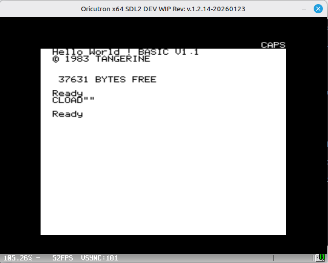
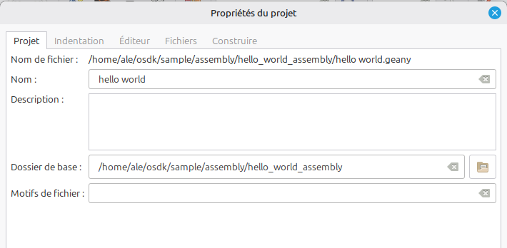
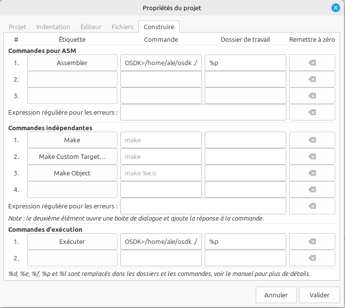
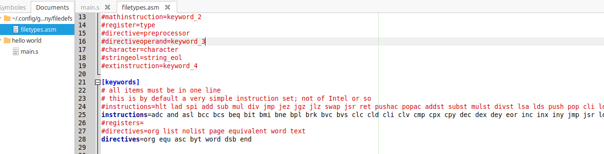

# Guide de Configuration OSDK et Compilation Oricutron

Ce document regroupe les procédures pour configurer les variables d'environnement de l'OSDK selon la plateforme (PC Linux Mint 64 bits 22.3 ou Raspberry Pi4 64 Bits) ainsi que les étapes de compilation de l'émulateur Oricutron sur Raspberry Pi 4.
meme si les fichiers binaires sont tous compilés pour les deux plateformes

---

## 1. Configuration de l'OSDK selon la plateforme

### Pour un PC et RPI4 64bits

# Récupérer le sous-dossier osdk du dépôt GitHub

```bash
git clone --depth 1 --filter=blob:none --sparse --branch main https://github.com/f4goh/oric.git
cd oric
git sparse-checkout set osdk
mv osdk ~/
```


```bash
# Installation des bibliothèques de développement additionnelles
sudo apt install -y libncurses-dev
sudo apt install -y mcpp
sudo apt install -y libfreeimage-dev

# Installation des outils de compilation et bibliothèques graphiques (SDL2 / GTK3)
sudo apt install -y git build-essential cmake libsdl2-dev libgtk-3-dev
```

### Pour un PC (Linux classique / Ubuntu / Debian)
Sur un ordinateur de bureau, les terminaux graphiques lisent le fichier de configuration `.bashrc` à chaque ouverture.

```bash
# Ouvrir le fichier de configuration
nano ~/.bashrc

# Ajouter la ligne suivante à la fin du fichier :
export OSDK="\$HOME/osdk"

# Recharger la configuration pour l'appliquer immédiatement
source ~/.bashrc
```

### Pour un Raspberry Pi (Armbian / Raspberry Pi OS)
Sur Raspberry Pi, l'environnement graphique nécessite que la variable soit déclarée globalement dans le fichier `.profile` pour être accessible depuis la console du bureau.

```bash
# Ouvrir le fichier de profil global
nano ~/.profile

# Ajouter la ligne suivante à la fin du fichier :
export OSDK="\$HOME/osdk"

# Recharger le profil pour l'appliquer immédiatement
source ~/.profile
```
*Note : Un redémarrage ou une reconnexion de la session graphique peut être nécessaire pour que le terminal du bureau l'active.*

---

## 2. Compilation d'Oricutron sur Raspberry Pi 4

Suivez cette série de commandes pour installer les dépendances nécessaires, récupérer le code source et compiler l'émulateur.

### Récupération des sources et compilation
```bash
# Cloner le dépôt officiel du projet
git clone https://github.com/HerbFargus/oricutron.git

# Entrer dans le répertoire du projet
cd oricutron

# Lister les fichiers pour vérification (optionnel)
ls

# Nettoyer les anciens résidus de compilation
make clean

# Lancer la compilation ciblée pour Raspberry Pi avec SDL2
make PLATFORM=rpi SDL_LIB=sdl2
```

L'exécutable généré nommé `oricutron` sera disponible directement à la racine du dossier.

## 3. Gestion des Binaires OSDK (PC vs Raspberry Pi)

Le répertoire de l'OSDK contient deux dossiers distincts pour les outils exécutables selon l'architecture de votre machine :
*   `bin` : Contient les exécutables binaires compilés pour **PC (Linux x86_64)**.
*   `bin-rpi` : Contient les exécutables binaires compilés spécifiquement pour le **Raspberry Pi (ARM)**.

### Configuration des outils pour une utilisation sur Raspberry Pi
Par défaut, les scripts de l'OSDK recherchent les outils de compilation (comme l'assembleur) directement dans le dossier nommé `bin`. 

Si vous utilisez ce dépôt sur votre Raspberry Pi, vous devez intervertir les dossiers en renommant `bin` en `bin-pc`, puis `bin-rpi` en `bin`. Éxecutez les commandes suivantes dans votre dossier `~/osdk` :

```bash
# Entrer dans le dossier osdk
cd ~/osdk

# Renommer le dossier des binaires PC d'origine
mv bin bin-pc

# Renommer le dossier des binaires Raspberry Pi pour le rendre actif
mv bin-rpi bin
```

Une fois cette manipulation effectuée, l'OSDK utilisera les bons outils ARM et vos scripts de compilation (comme `./build.sh`) fonctionneront nativement sur la console du Raspberry Pi.

## 4. Exemple Pratique : Compilation et Exécution d'un Programme

Voici le déroulement complet pour compiler et lancer l'exemple officiel "Hello World" en assembleur fourni avec l'OSDK.

### Étape 4.1 : Navigation vers le projet exemple
Pour commencer, placez-vous dans le répertoire de l'exemple d'assembleur depuis la racine du dossier `osdk` :
```bash
cd ~/osdk/sample/assembly/hello_world_assembly
```

### Étape 4.2 : Compilation du code source (`build.sh`)
Lancez le script de construction pour assembler le code source `main.s` et générer l'image cassette finale `.tap` lisible par l'émulateur :
```bash
./build.sh
```

**Retour attendu de la console :**
```text
Building the program HWASM at address $800 [OSDK unknown]
Assembling main.s
Linking
Assembling
Creating TAPE image HWASM.tap
File 'BUILD/HWASM.tap' is 63 bytes long (14 bytes header and 49 bytes of data)
Build of HWASM.tap finished in 0s.
```
*Note : Le fichier binaire résultant `HWASM.tap` se trouve désormais encapsulé dans le sous-dossier virtuel `BUILD/`.*

### Étape 4.3 : Exécution du programme dans l'émulateur (`execute.sh`)
Pour tester votre programme fraîchement compilé dans l'émulateur Oricutron configuré au sein de votre environnement, lancez le script d'exécution :
```bash
./execute.sh
```

**Retour attendu de la console :**
```text
Lancement d'Oricutron (SDL2) avec le fichier : BUILD/HWASM.tap...
```

Une fenêtre graphique **Oricutron** va s'ouvrir automatiquement à l'écran de votre machine (PC ou bureau Armbian) pour charger l'image cassette virtuelle et exécuter votre code machine.



## 5. Exemple Pratique : Compilation d'un Programme Mixte (C / BASIC / Assembleur)

L'OSDK permet également de compiler des projets hybrides mariant le BASIC (pour la logique globale) et l'assembleur (pour les routines rapides, comme le défilement graphique).

### Étape 5.1 : Navigation vers le projet exemple
Depuis la racine du dossier `osdk`, accédez au sous-répertoire de l'exemple de défilement (*scrolling*) :
```bash
cd ~/osdk/sample/c/basic_with_assembler/scrolling
```

### Étape 5.2 : Compilation du projet mixte (`build.sh`)
Exécutez le script de construction. Celui-ci va assembler le code bas niveau `scrolling.s` et convertir le programme de haut niveau `main.bas` afin de fusionner le tout dans une seule image cassette :
```bash
./build.sh
```

**Retour attendu de la console :**
```text
Building the program ITALICS at address $8000 [OSDK unknown]
Assembling scrolling.s
Converting BASIC program main.bas
Linking
Assembling
Creating TAPE image ITALICS.tap
File 'BUILD/ITALICS.tap' is 200 bytes long (14 bytes header and 186 bytes of data)
Preparing payload for the BASIC program
Generating TAPE file from BASIC source code
Build of ITALICS.tap finished in 0s.
```
*Note : Le compilateur génère ici un fichier conteneur final nommé `ITALICS.tap` au sein du sous-dossier `BUILD/`.*

### Étape 5.3 : Exécution de l'exemple hybride (`execute.sh`)
Pour lancer le programme généré directement dans l'émulateur Oricutron, tapez la commande suivante :
```bash
./execute.sh
```

**Retour attendu de la console :**
```text
Lancement d'Oricutron (SDL2) avec le fichier : BUILD/ITALICS.tap...
```

## 6. Intégration dans l'IDE Geany (Compilation et Exécution)

Il est possible d'automatiser le développement Oric en configurant **Geany** pour qu'il utilise directement vos scripts OSDK via les touches de raccourci standards de l'IDE :
*   **F8 (Compiler) :** Lance l'assemblage et la génération du fichier `.tap`.
*   **F5 (Exécuter) :** Ouvre automatiquement l'émulateur Oricutron.

---

### Étape 6.1 : Ouverture du projet dans Geany
Plutôt que de créer un projet complexe, Geany permet de travailler directement dans le dossier de code :
1. Lancez **Geany**.
2. Allez dans le menu **Fichier > Ouvrir**.
3. Naviguez vers le dossier de l'exemple précédent : `/home/ale/osdk/sample/assembly/hello_world_assembly/`.
4. Ouvrez le fichier de code source principal : `main.s`.

---

## 6. Intégration dans l'IDE Geany (Projet, Compilation et Exécution)

Pour travailler proprement, il est préférable de créer un **Projet Geany**. Cela permet de fixer le répertoire de travail et de retrouver instantanément vos fichiers. Nous allons configurer l'IDE pour utiliser les touches de raccourci suivantes :
*   **F8 (Compiler) :** Lance l'assemblage et la génération du fichier `.tap`.
*   **F5 (Exécuter) :** Ouvre automatiquement l'émulateur Oricutron.

---

### Étape 6.1 : Création du projet dans Geany

Avant de configurer les commandes, créez le projet pour cibler le bon dossier :

1. Lancez **Geany**.
2. Allez dans le menu **Projet > Nouveau**.
3. Remplissez les champs de la fenêtre ainsi :
   *   **Nom :** `HelloWorld_ASM`
   *   **Nom de fichier :** `/home/ale/osdk/sample/assembly/hello_world_assembly/HelloWorld_ASM.geany`
   *   **Dossier de base :** `/home/ale/osdk/sample/assembly/hello_world_assembly`
4. Cliquez sur **Créer**.
5. Ouvrez ensuite le fichier source principal `main.s` (qui apparaît maintenant dans l'arbre du projet à gauche ou via *Fichier > Ouvrir*).



---

### Étape 6.2 : Configuration des commandes de construction

Le dossier de base du projet étant verrouillé sur votre exemple, nous allons lier les commandes OSDK aux touches de raccourci :

1. Dans la barre des menus de Geany, cliquez sur **Développer > Définir les commandes de construction**.
2. Dans la fenêtre de configuration, repérez la section **Commandes de fichier indépendantes** en haut.

#### Configuration de la touche F8 (Assembler / Compiler)
*   Sur la première ligne (généralement nommée *Compiler*), modifiez les champs ainsi :
    *   **Étiquette :** `Assembler OSDK`
    *   **Commande :** `OSDK=/home/ale/osdk ./build.sh`
    *   **Dossier de travail :** `%p`

#### Configuration de la touche F5 (Exécuter)
*   Repérez la section **Commandes d'exécution** en bas (généralement nommée *Exécuter*). Modifiez les champs ainsi :
    *   **Étiquette :** `Exécuter Oricutron`
    *   **Commande :** `OSDK=/home/ale/osdk ./execute.sh`
    *   **Dossier de travail :** `%p`

> **Explication des paramètres :**
> *   `OSDK=/home/ale/osdk` : Force l'injection de la variable d'environnement juste avant l'exécution du script, garantissant le bon fonctionnement de l'OSDK.
> *   `%p` : Variable interne de Geany indiquant le dossier de base du projet actif (ici `/home/ale/osdk/sample/assembly/hello_world_assembly`). Les scripts `./build.sh` et `./execute.sh` seront donc toujours lancés au bon endroit.

Cliquez sur **Valider** pour enregistrer.



---

### Étape 6.3 : Utilisation au quotidien

Vous pouvez désormais coder et tester sans jamais ouvrir le terminal :

1. Modifiez votre code source dans l'éditeur (le fichier `main.s`).
2. Appuyez sur **F8** : Geany assemble votre code et génère l'image cassette. Le rapport s'affiche dans l'onglet *Compilateur* en bas de Geany.
3. Appuyez sur **F5** : Geany lance votre script et ouvre automatiquement la fenêtre de l'émulateur **Oricutron** avec votre programme prêt à s'exécuter.

##Étape 7 : Configuration et Colorisation Syntaxique pour l'Assembleur 6502 (OSDK / Oric)

### Étape 7.1 Bloc de configuration des mots-clés

Remplacez la section `[keywords]` existante dans votre fichier de configuration par les lignes suivantes pour prendre en charge le jeu d'instructions complet du processeur 6502 ainsi que les directives de l'OSDK :

```ini
[keywords]
instructions=adc and asl bcc bcs beq bit bmi bne bpl brk bvc bvs clc cld cli clv cmp cpx cpy dec dex dey eor inc inx iny jmp jsr lda ldx ldy lsr nop ora pha php pla plp ror rti rts sbc sec sed sei sta stx sty tax tay tsx txa txs tya
directives=org equ asc byt word dsb end
```

### Étape 7.2  Procédure pour activer la colorisation dans l'éditeur

Pour appliquer cette configuration et coloriser correctement vos mnémoniques (fichiers `.asm`), utilisez les menus de votre éditeur (comme Geany) en suivant ce chemin :

1. Cliquez sur le menu **Document** en haut de la fenêtre.
2. Allez sur **Définir le type de fichier**.
3. Choisissez **Langages de programmation**.
4. Sélectionnez **Fichier assembleur** (ou **Fichier de script ASM**).




